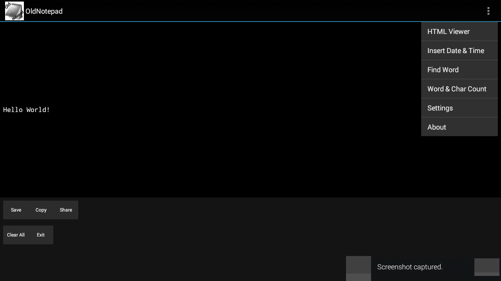

# 📒 OldNotepad 📝

**Простой и при этом очень технологичный блокнот, созданный для Android 3.2+ и экранов 16:9!**

<a href="README.md">English</a> •
<a href="README-uk.md">Українська</a> •
<a href="README-ru.md">Русский</a>

---

## 📸 Preview

Кадры в формате 16:9, снятые на экране телевизора:

<table>
  <tr>
    <td width="50%" align="center">
      
       
      <b>Главный экран (screenshot.png)</b>
    </td>
    <td width="50%" align="center">
      
       
      <b>Экран 1 (screenshot1.png)</b>
    </td>
  </tr>
  <tr>
    <td width="50%" align="center">
      
       
      <b>Экран 2 (screenshot2.png)</b>
    </td>
    <td width="50%" align="center">
      
       
      <b>Экран 3 (screenshot3.png)</b>
    </td>
  </tr>
  <tr>
    <td width="50%" align="center">
      
       
      <b>Экран 4 (screenshot4.png)</b>
    </td>
    <td width="50%" align="center">
      
       
      <b>Экран 5 (screenshot5.png)</b>
    </td>
  </tr>
  <tr>
    <td width="50%" align="center">
      
       
      <b>Экран 6 (screenshot6.png)</b>
    </td>
    <td width="50%" align="center">
      
       
      <b>Экран 7 (screenshot7.png)</b>
    </td>
  </tr>
  <tr>
    <td colspan="2" align="center">
      
       
      <b>Экран 8 (screenshot8.png)</b>
    </td>
  </tr>
</table>

## О проекте и возможностях

- **Простота и технологичность:** удобный блокнот с технологичной основой для **Android 3.2+**.
- **Формат 16:9 для ТВ:** чёткое отображение на широких экранах и телевизорах.
- **Заметка о подписи:** APK подписан тестовым ключом; если следующие версии будут подписаны другим ключом, перед обновлением может потребоваться удалить предыдущую сборку.

## Участие в разработке

Правила участия смотрите в файле [CONTRIBUTING.ru.md](CONTRIBUTING.ru.md).

## Лицензия

Лицензия [MIT License](LICENSE) — © 2026 ByteTools Inc (MSN Man). Копировать приложение запрещено.
