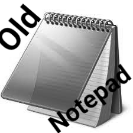
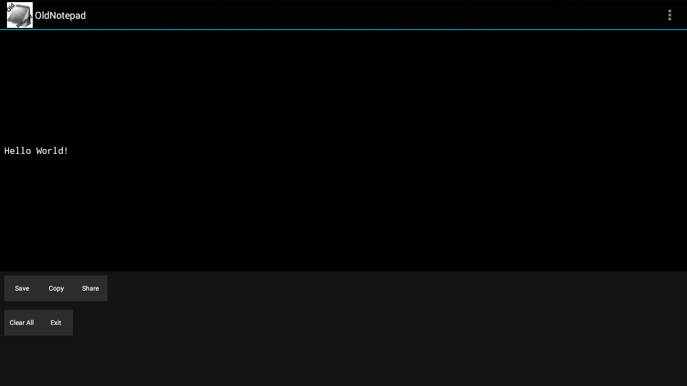
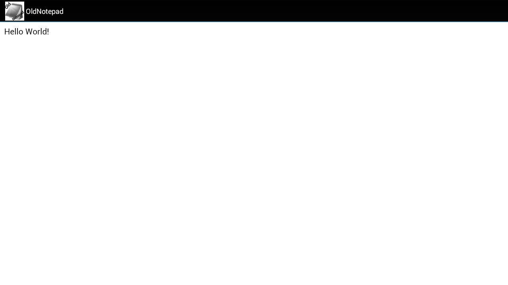
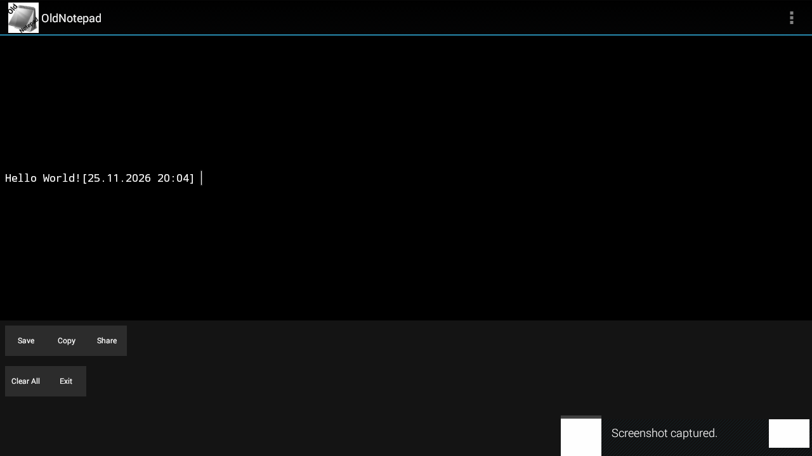
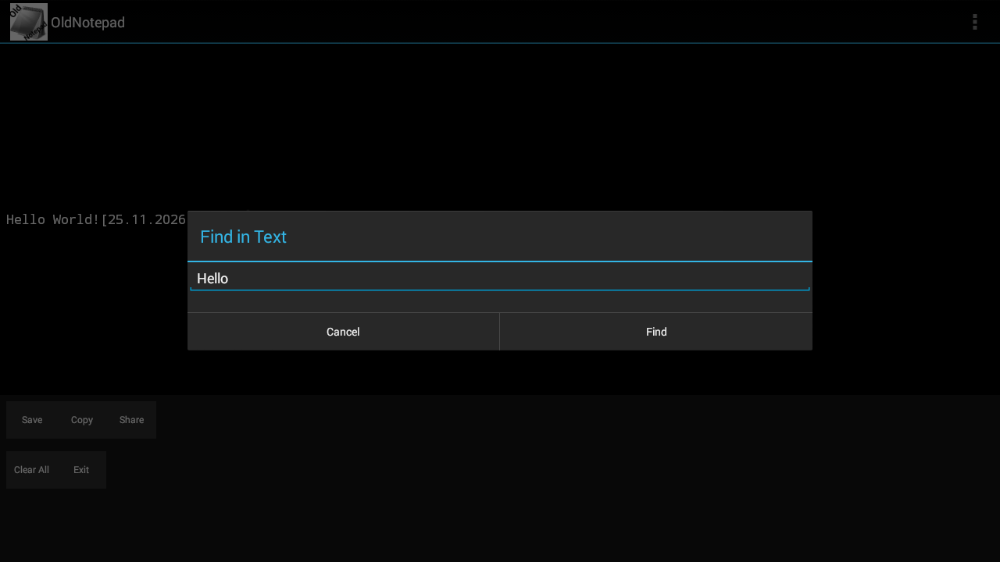
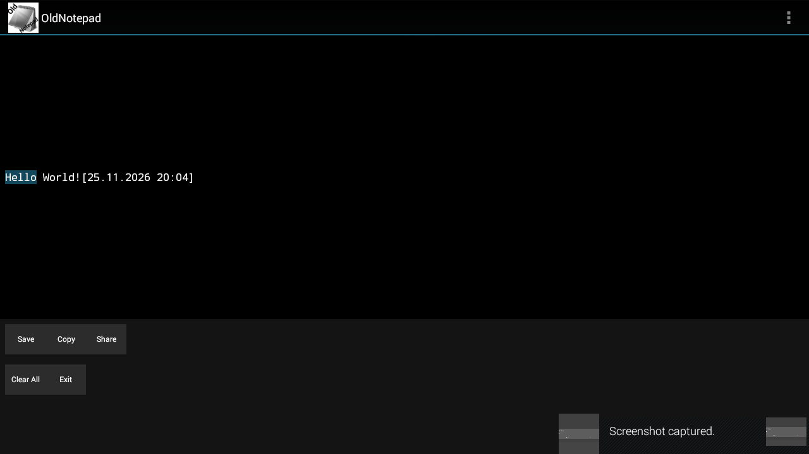
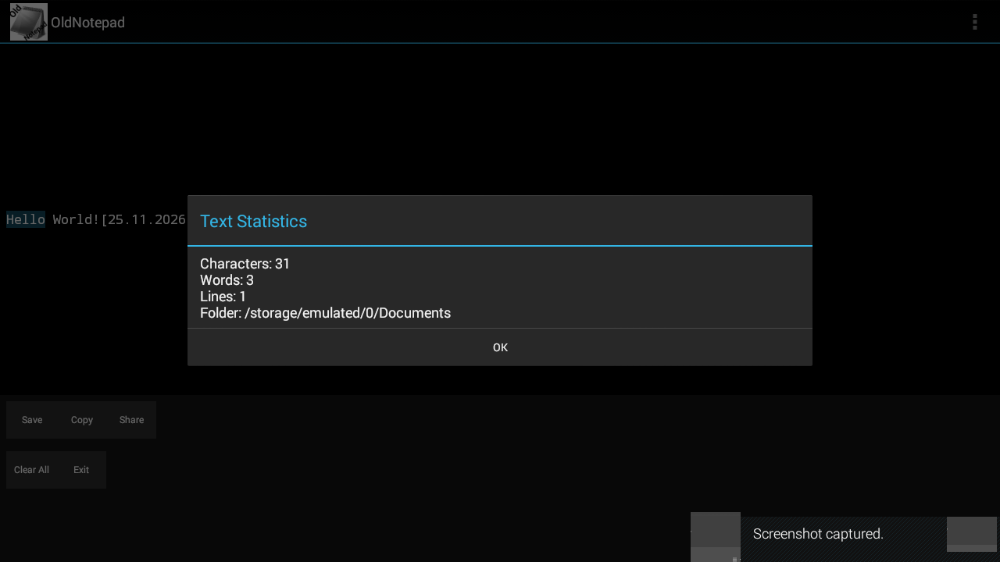
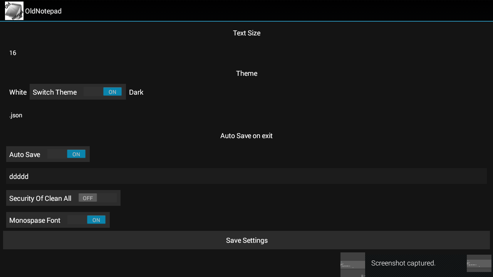
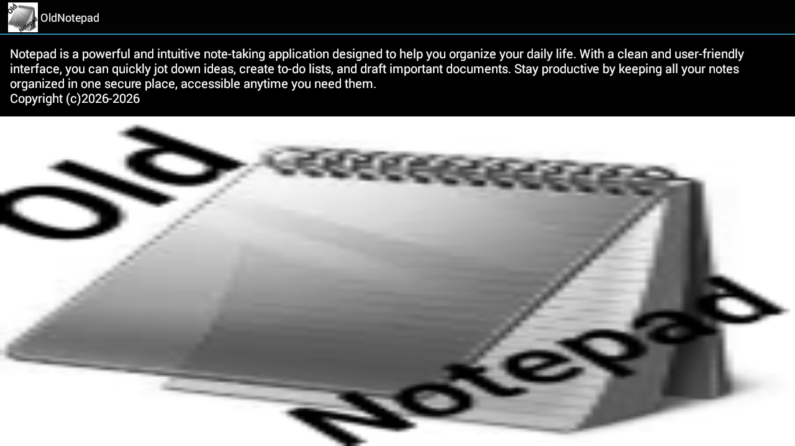

  

  # OldNotepad

  **Простой и при этом очень технологичный блокнот, созданный для Android 3.2+.**

  <a href="README.md">English</a> •
  <a href="README-uk.md">Українська</a> •
  <a href="README-ru.md">Русский</a>

   
  <a href="#о-проекте">О проекте</a> •
  <a href="#возможности">Возможности</a> •
  <a href="#скриншоты">Скриншоты</a> •
  <a href="#участие-в-разработке">Участие в разработке</a> •
  <a href="#лицензия">Лицензия</a>

---

## О проекте

**OldNotepad** — это простой блокнот с продуманной технологической основой, созданный для **Android 3.2+**. Он сочетает удобную работу с заметками без лишних деталей и стабильное отображение на широкоформатных экранах 16:9.

## Возможности

- **Простота и технологичность** — Лаконичная работа с текстом и технологичная основа для **Android 3.2+**.
- **Формат 16:9 для ТВ** — Чёткая структура и читаемые элементы на широких экранах телевизора.
- **Документация на трёх языках** — Описание и правила участия доступны на русском, английском и украинском языках.

## Скриншоты

Кадры в формате 16:9, снятые на экране телевизора:

<table>
  <tr>
    <td width="50%" align="center">
      
       
      <b>Главный экран (screenshot.png)</b>
    </td>
    <td width="50%" align="center">
      
       
      <b>Экран 1 (screenshot1.png)</b>
    </td>
  </tr>
  <tr>
    <td width="50%" align="center">
      
       
      <b>Экран 2 (screenshot2.png)</b>
    </td>
    <td width="50%" align="center">
      
       
      <b>Экран 3 (screenshot3.png)</b>
    </td>
  </tr>
  <tr>
    <td width="50%" align="center">
      
       
      <b>Экран 4 (screenshot4.png)</b>
    </td>
    <td width="50%" align="center">
      
       
      <b>Экран 5 (screenshot5.png)</b>
    </td>
  </tr>
  <tr>
    <td width="50%" align="center">
      
       
      <b>Экран 6 (screenshot6.png)</b>
    </td>
    <td width="50%" align="center">
      
       
      <b>Экран 7 (screenshot7.png)</b>
    </td>
  </tr>
  <tr>
    <td colspan="2" align="center">
      
       
      <b>Экран 8 (screenshot8.png)</b>
    </td>
  </tr>
</table>

## Участие в разработке

Будем рады идеям, сообщениям об ошибках и помощи проекту. Перед открытием Issue или Pull Request ознакомьтесь с [CONTRIBUTING.ru.md](CONTRIBUTING.ru.md).

## Лицензия

Проект распространяется по лицензии [MIT License](LICENSE) — © 2026 ByteTools Inc (MSN Man).
