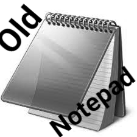
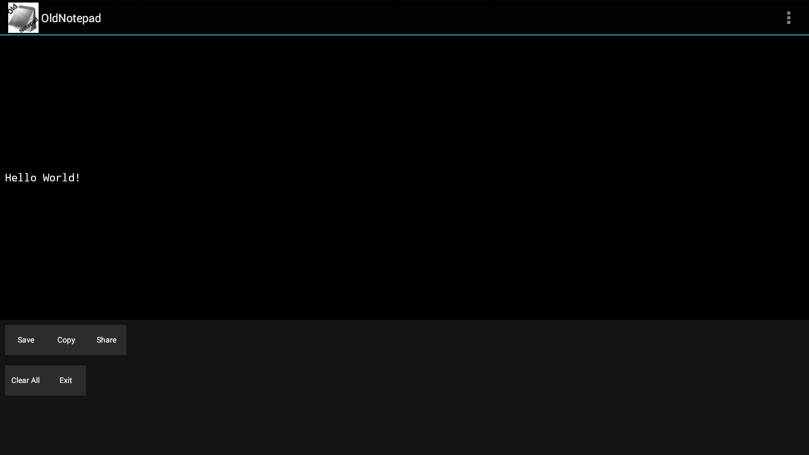
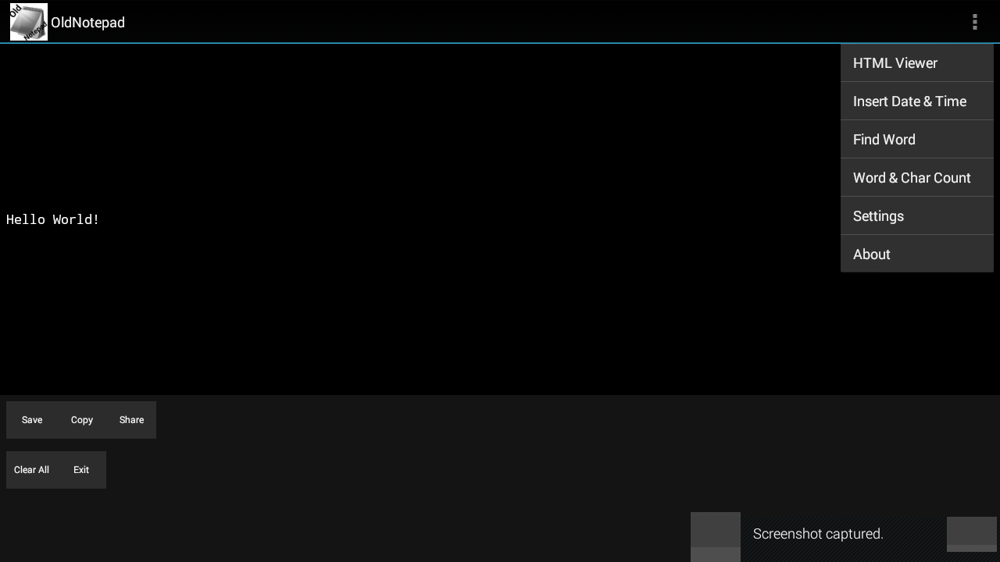
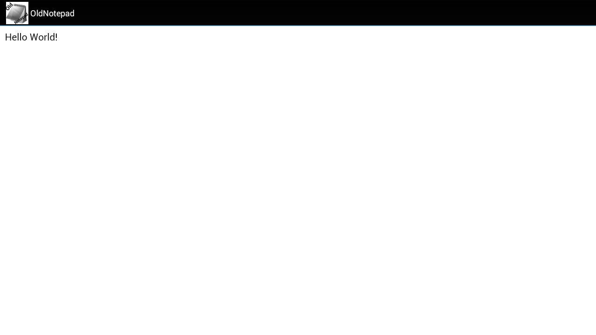
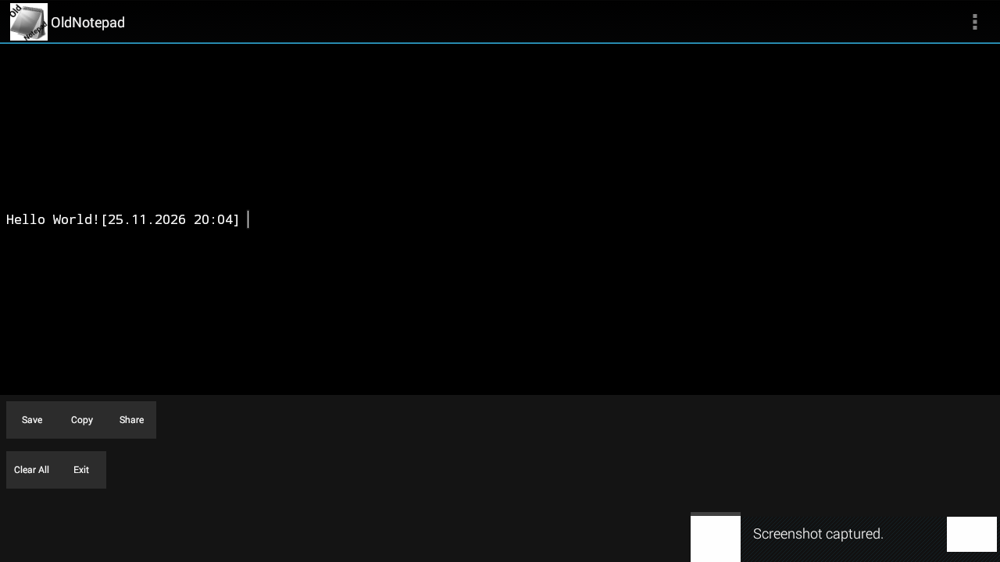
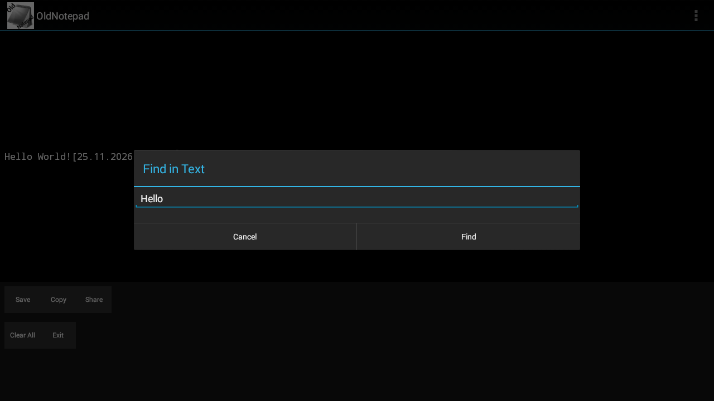
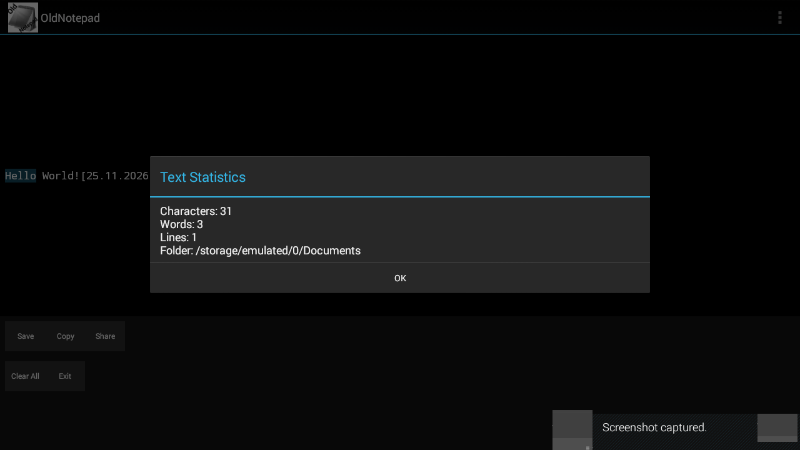
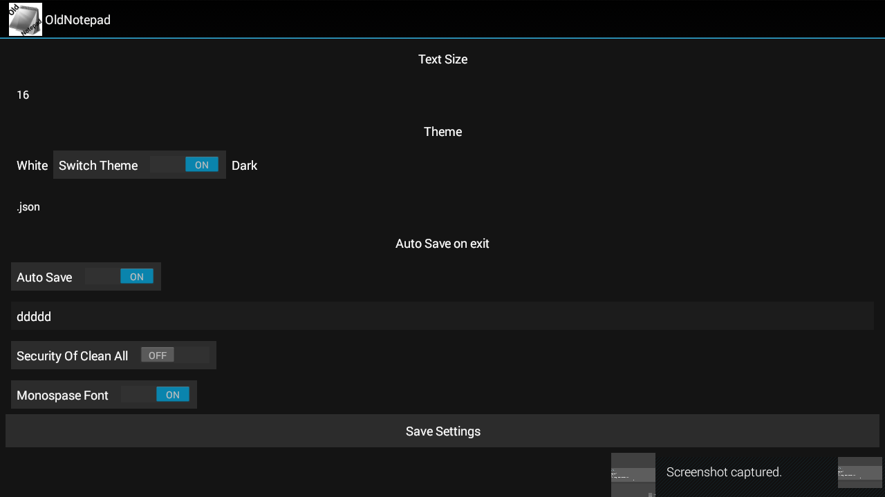
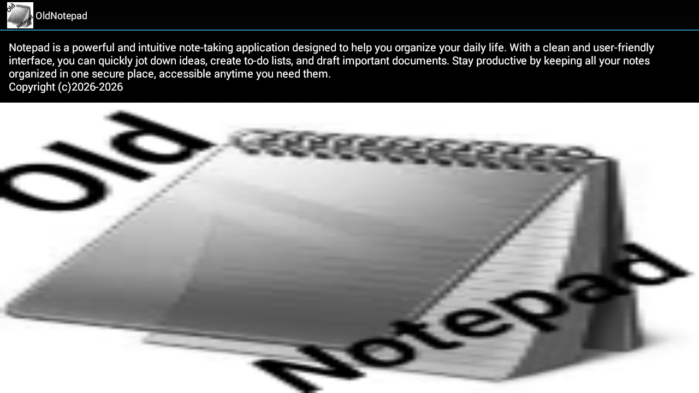

  

  # OldNotepad

  **Простий і водночас дуже технологічний блокнот, створений для Android 3.2+.**

  <a href="README.md">English</a> •
  <a href="README.uk.md">Українська</a> •
  <a href="README.ru.md">Русский</a>

   
  <a href="#про-проєкт">Про проєкт</a> •
  <a href="#можливості">Можливості</a> •
  <a href="#скріншоти">Скріншоти</a> •
  <a href="#участь-у-розробці">Участь у розробці</a> •
  <a href="#ліцензія">Ліцензія</a>

---

## Про проєкт

**OldNotepad** — це простий блокнот із продуманою технологічною основою, створений для **Android 3.2+**. Він поєднує зручну роботу з нотатками без зайвого шуму та стабільну поведінку на екранах формату 16:9.

## Можливості

- **Простота й технологічність** — Зрозумілий інтерфейс і технологічна база для **Android 3.2+**.
- **Адаптація під 16:9** — Чітке відображення та зручна компоновка на широкоформатних екранах телевізора.
- **Документація трьома мовами** — Опис та правила участі доступні українською, англійською та російською мовами.

## Скріншоти

Знімки екрана у форматі 16:9, зроблені на телевізорі:

<table>
  <tr>
    <td width="50%" align="center">
      
       
      <b>Головний екран (screenshot.png)</b>
    </td>
    <td width="50%" align="center">
      
       
      <b>Екран 1 (screenshot1.png)</b>
    </td>
  </tr>
  <tr>
    <td width="50%" align="center">
      
       
      <b>Екран 2 (screenshot2.png)</b>
    </td>
    <td width="50%" align="center">
      
       
      <b>Екран 3 (screenshot3.png)</b>
    </td>
  </tr>
  <tr>
    <td width="50%" align="center">
      
       
      <b>Екран 4 (screenshot4.png)</b>
    </td>
    <td width="50%" align="center">
      
       
      <b>Екран 5 (screenshot5.png)</b>
    </td>
  </tr>
  <tr>
    <td width="50%" align="center">
      
       
      <b>Екран 6 (screenshot6.png)</b>
    </td>
    <td width="50%" align="center">
      
       
      <b>Екран 7 (screenshot7.png)</b>
    </td>
  </tr>
  <tr>
    <td colspan="2" align="center">
      
       
      <b>Екран 8 (screenshot8.png)</b>
    </td>
  </tr>
</table>

## Участь у розробці

Будемо раді вашим ідеям, звітам про помилки та внеску в розвиток. Перед створенням Issue або Pull Request ознайомтеся з [CONTRIBUTING.uk.md](CONTRIBUTING.uk.md).

## Ліцензія

Проєкт поширюється за ліцензією [MIT License](LICENSE) — © 2026 ByteTools Inc (MSN Man).
