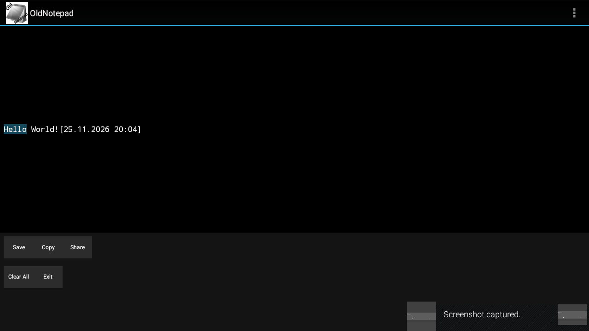

# 📒 OldNotepad 📝

**Простий і водночас дуже технологічний блокнот, створений для Android 3.2+ та екранів 16:9!**

<a href="README.md">English</a> •
<a href="README-uk.md">Українська</a> •
<a href="README-ru.md">Русский</a>

---

## 📸 Preview

Знімки екрана у форматі 16:9, зроблені на телевізорі Vilgrand:

<table>
  <tr>
    <td width="50%" align="center">
      
       
      <b>Головний екран (screenshot.png)</b>
    </td>
    <td width="50%" align="center">
      
       
      <b>Екран 1 (screenshot1.png)</b>
    </td>
  </tr>
  <tr>
    <td width="50%" align="center">
      
       
      <b>Екран 2 (screenshot2.png)</b>
    </td>
    <td width="50%" align="center">
      
       
      <b>Екран 3 (screenshot3.png)</b>
    </td>
  </tr>
  <tr>
    <td width="50%" align="center">
      
       
      <b>Екран 4 (screenshot4.png)</b>
    </td>
    <td width="50%" align="center">
      
       
      <b>Екран 5 (screenshot5.png)</b>
    </td>
  </tr>
  <tr>
    <td width="50%" align="center">
      
       
      <b>Екран 6 (screenshot6.png)</b>
    </td>
    <td width="50%" align="center">
      
       
      <b>Екран 7 (screenshot7.png)</b>
    </td>
  </tr>
  <tr>
    <td colspan="2" align="center">
      
       
      <b>Екран 8 (screenshot8.png)</b>
    </td>
  </tr>
</table>

## Про проєкт та можливості

- **Простота й технологічність:** зручний блокнот із сильною технологічною базою для **Android 3.2+**.
- **Формат 16:9 для ТВ:** чітка компоновка та зручний перегляд на екранах телевізорів і широких дисплеях.
- **Примітка про ключ:** APK підписаний тестовим ключем; якщо наступні збірки матимуть інший ключ, перед оновленням може знадобитися видалити попередню версію.

## Участь у розробці

Дивіться правила у файлі [CONTRIBUTING.uk.md](CONTRIBUTING.uk.md).

## Ліцензія

Ліцензія [MIT License](LICENSE) — © 2026 ByteTools Inc (MSN Man). Копіювати додаток заборонено.
