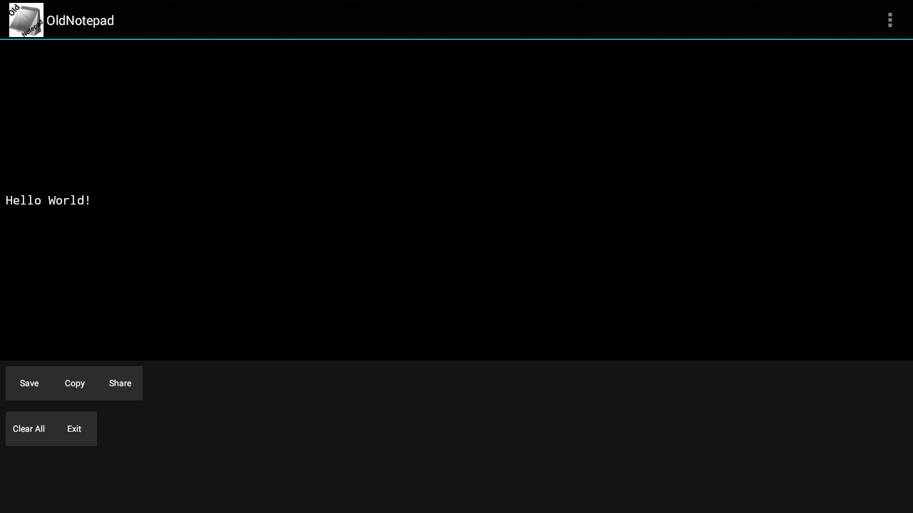
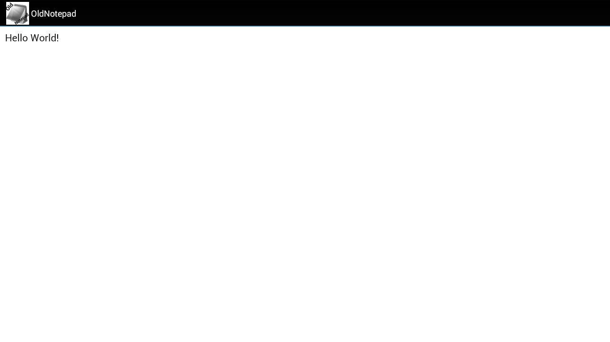
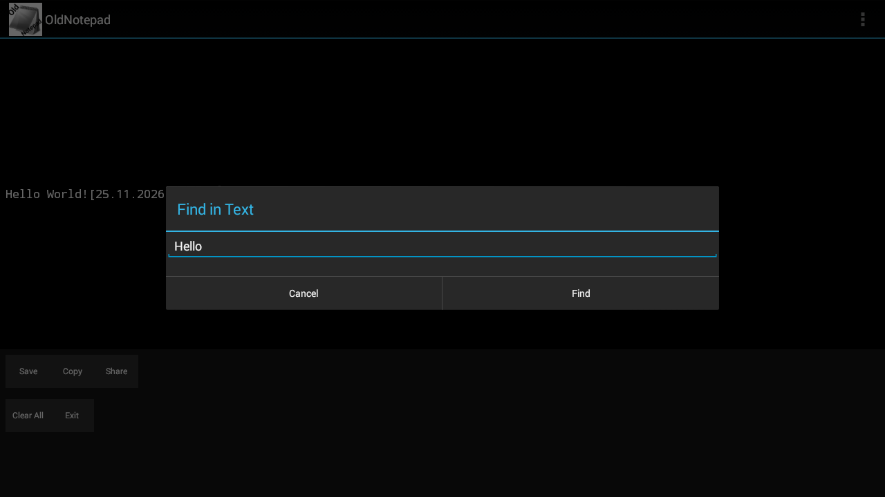

  

  # OldNotepad

  **A simple yet highly technological notepad crafted for Android 3.2+.**

  <a href="README.md">English</a> •
  <a href="READMEuk.md">Українська</a> 
  <a href="README-ru.md">Русский</a>

   
  <a href="#about">About</a> •
  <a href="#features">Features</a> •
  <a href="#screenshots">Screenshots</a> •
  <a href="#contributing">Contributing</a> •
  <a href="#license">License</a>

---

## About

**OldNotepad** is a simple notepad built with a strong technological core for **Android 3.2+**. It keeps note-taking clean, fast, and uncluttered while delivering reliable performance on both classic and modern 16:9 displays.

## Features

- **Simple & Technological** — Straightforward writing experience backed by solid engineering for **Android 3.2+**.
- **TV-Ready 16:9 Presentation** — Clear layout and readable elements suited for 16:9 widescreen viewing.
- **Multilingual Documentation** — Guides and rules available in English, Ukrainian, and Russian.

## Screenshots

16:9 widescreen captures taken on a TV display:

<table>
  <tr>
    <td width="50%" align="center">
      
       
      <b>Main View (screenshot.png)</b>
    </td>
    <td width="50%" align="center">
      
       
      <b>Screen 1 (screenshot1.png)</b>
    </td>
  </tr>
  <tr>
    <td width="50%" align="center">
      
       
      <b>Screen 2 (screenshot2.png)</b>
    </td>
    <td width="50%" align="center">
      
       
      <b>Screen 3 (screenshot3.png)</b>
    </td>
  </tr>
  <tr>
    <td width="50%" align="center">
      
       
      <b>Screen 4 (screenshot4.png)</b>
    </td>
    <td width="50%" align="center">
      
       
      <b>Screen 5 (screenshot5.png)</b>
    </td>
  </tr>
  <tr>
    <td width="50%" align="center">
      
       
      <b>Screen 6 (screenshot6.png)</b>
    </td>
    <td width="50%" align="center">
      
       
      <b>Screen 7 (screenshot7.png)</b>
    </td>
  </tr>
  <tr>
    <td colspan="2" align="center">
      
       
      <b>Screen 8 (screenshot8.png)</b>
    </td>
  </tr>
</table>

## Contributing

Contributions, bug reports, and ideas are always welcome. Please check [CONTRIBUTING.md](CONTRIBUTING.md) before opening an issue or pull request.

## License

This project is licensed under the [MIT License](LICENSE) — © 2026 ByteTools Inc (MSN Man).
