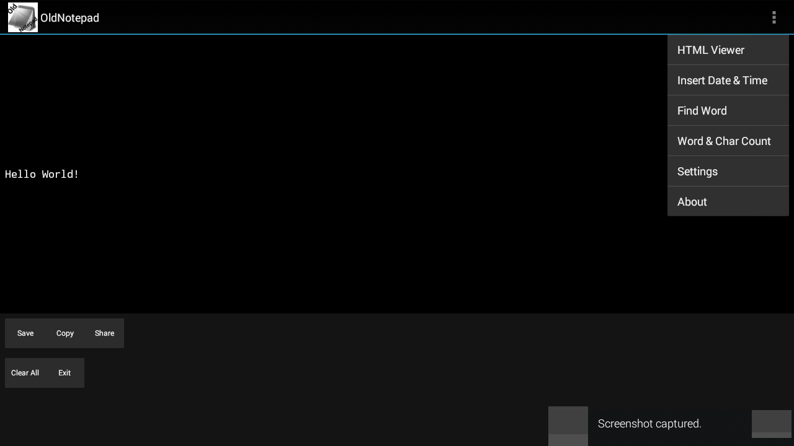
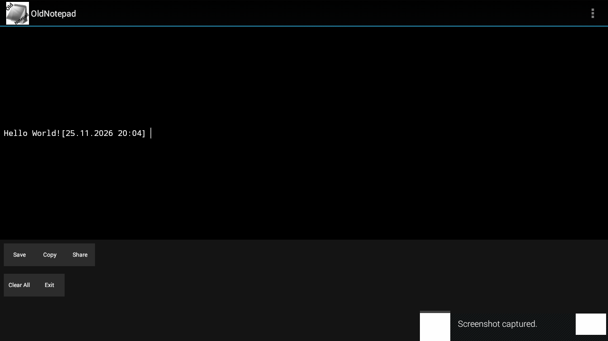
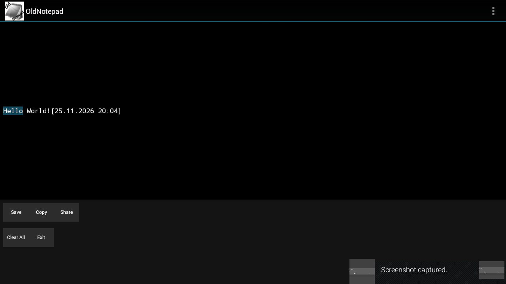
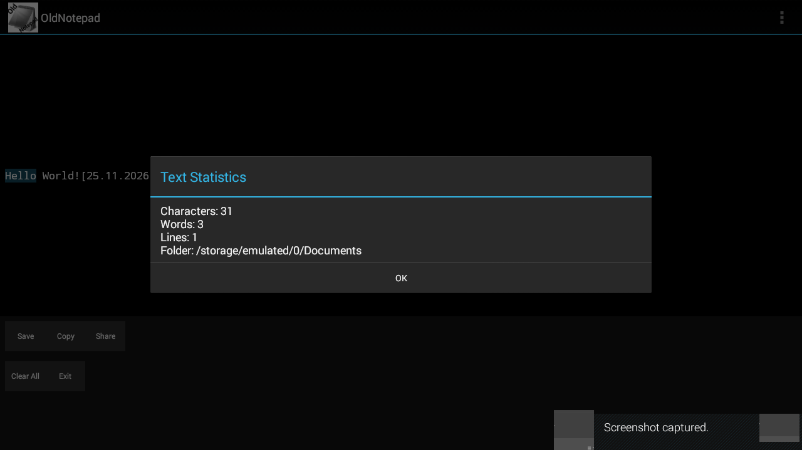
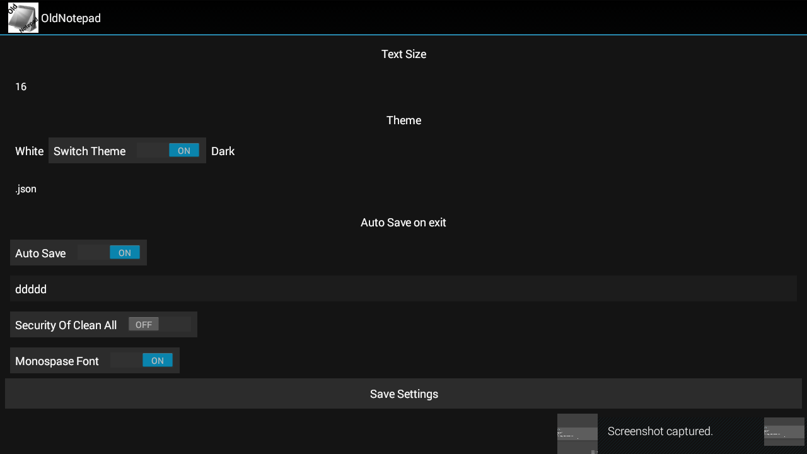
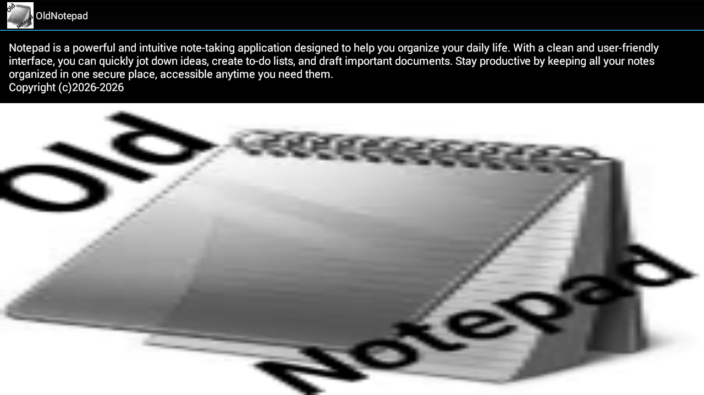

# 📒 OldNotepad 📝 

**A simple yet highly technological notepad crafted for Android 3.2+ and 16:9 widescreen displays!**

<a href="README.md">English</a> •
<a href="README-uk.md">Українська</a> •
<a href="README-ru.md">Русский</a>

---

## 📸 Preview

16:9 widescreen captures taken on a TV display:

<table>
  <tr>
    <td width="50%" align="center">
      
       
      <b>Main View (screenshot.png)</b>
    </td>
    <td width="50%" align="center">
      
       
      <b>Screen 1 (screenshot1.png)</b>
    </td>
  </tr>
  <tr>
    <td width="50%" align="center">
      
       
      <b>Screen 2 (screenshot2.png)</b>
    </td>
    <td width="50%" align="center">
      
       
      <b>Screen 3 (screenshot3.png)</b>
    </td>
  </tr>
  <tr>
    <td width="50%" align="center">
      
       
      <b>Screen 4 (screenshot4.png)</b>
    </td>
    <td width="50%" align="center">
      
       
      <b>Screen 5 (screenshot5.png)</b>
    </td>
  </tr>
  <tr>
    <td width="50%" align="center">
      
       
      <b>Screen 6 (screenshot6.png)</b>
    </td>
    <td width="50%" align="center">
      
       
      <b>Screen 7 (screenshot7.png)</b>
    </td>
  </tr>
  <tr>
    <td colspan="2" align="center">
      
       
      <b>Screen 8 (screenshot8.png)</b>
    </td>
  </tr>
</table>

## About & Features

- **Simple & Technological:** Straightforward note-taking backed by solid engineering for **Android 3.2+**.
- **16:9 TV Ready:** Clean layout adapted for 16:9 widescreen screens and TVs.
- **Test Key Notice:** Release builds are signed with a test key; uninstalling the previous version may be required if future builds use a different signing key.

## Contributing

See [CONTRIBUTING.md](CONTRIBUTING.md) for guidelines.

## License

Licensed under the [MIT License](LICENSE) — © 2026 ByteTools Inc (MSN Man). Copying this app is prohibited.
